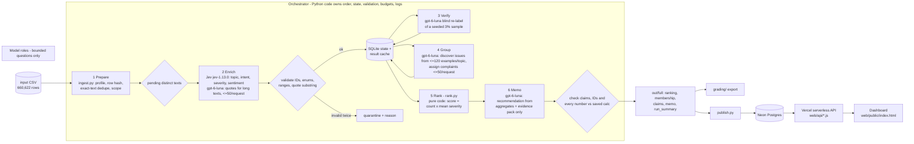

# Spotify Review Insights: a multi-agent review pipeline

**Question:** at the end of the review window, should Spotify's next quarter of product effort go to **access, usability, playback, or billing/support**?

**Answer: usability, starting with excessive ad interruptions (`USB-01`).** Usability leads the actionable areas: 13,516 complaint/cancellation reviews and severity sum 37,865, vs playback 8,199 / 27,479 and billing/support 7,859 / 22,279 ([`area_totals.csv`](out/full/area_totals.csv)). `USB-01` is the highest-ranked specific issue: 7,520 complaints (C3), mean severity 2.798271 (C4), priority score 21,043 (C5). The #1 baseline row is the catch-all `OTH-99` "general dissatisfaction" (35,769 complaints, C1; mean severity 1.830747, C2); it names no feature, so it is reported but not treated as a roadmap item. Full memo: [`out/full/memo.md`](out/full/memo.md). Claims: [`grading/claims.csv`](grading/claims.csv).

| | |
|---|---|
| **Live dashboard** | **https://spotify-review-insights-roan.vercel.app** (public, no login) |
| Backend API (Vercel serverless, reads Neon Postgres) | [`/api/summary`](https://spotify-review-insights-roan.vercel.app/api/summary), [`/api/ranking`](https://spotify-review-insights-roan.vercel.app/api/ranking), [`/api/recommendation`](https://spotify-review-insights-roan.vercel.app/api/recommendation), [`/api/issue?id=USB-01`](https://spotify-review-insights-roan.vercel.app/api/issue?id=USB-01), [`/api/review?id=cd8bf064-c32e-400e-906e-a4d900819bbd`](https://spotify-review-insights-roan.vercel.app/api/review?id=cd8bf064-c32e-400e-906e-a4d900819bbd), [`/api/trend`](https://spotify-review-insights-roan.vercel.app/api/trend), [`/api/evals`](https://spotify-review-insights-roan.vercel.app/api/evals) |
| Database | Neon Postgres: `records` (all 660,622), `issues`, `ranking`, `membership`, `claims`, `memo`, `monthly`, `evals`, `run_meta`. Loaded by [`pipeline/publish.py`](pipeline/publish.py) |
| Grading export | [`grading/`](grading/) (records/calls gzipped). Course checker: [`out/full/self-check.json`](out/full/self-check.json) |
| Result files | [`enriched.jsonl.gz`](out/full/enriched.jsonl.gz) (237,987 completed) · [`quarantine.jsonl.gz`](out/full/quarantine.jsonl.gz) (422,635 with reason + attempts) · [`issues_catalog.json`](out/full/issues_catalog.json) · [`membership.csv`](out/full/membership.csv) · [`aggregates.csv`](out/full/aggregates.csv) · [`ranking.csv`](out/full/ranking.csv) · [`run_log.jsonl`](out/full/run_log.jsonl) · [`run_summary.json`](out/full/run_summary.json) · [`run_manifest.json`](out/full/run_manifest.json) |
| Schema and prompts | [`schema/output_schema.json`](schema/output_schema.json) · [`prompts/`](prompts/) (Jev questions, quote, verifier, group discover/assign, memo prompts, and all structured-output schemas) · labels and examples in [`pipeline/labels.py`](pipeline/labels.py) |
| Cost calculator | [`cost/`](cost/) · [report](cost/report.md) · offline replay: `python cost/calculator.py` |
| Interruption/resume recording | [`evals/recovery/interruption_resume_recording.mp4`](evals/recovery/interruption_resume_recording.mp4) |

## Results summary

| | |
|---|---|
| Source rows ingested and accounted for | **660,622 / 660,622** (profile exactly matches the course helper; [`ingestion_report.json`](out/ingestion_report.json)) |
| Declared classification scope | the lowest **100,050** IDs by the course's own seeded hash order (= golden 50 + all dev checkpoints + 90,000 more) |
| Completed classifications | **237,987** = 100,050 in-scope (100%) + 137,937 out-of-scope IDs whose exact text matches an in-scope text |
| Exact-text cache reuse | 159,850 records reuse a validated label via `cache_source_id`; only 78,137 distinct texts were sent to models |
| Quarantined | 13 empty texts (`empty_review_text`). Enrichment-invalid: 0 |
| Not classified | **422,622** out-of-scope nonempty reviews with no exact-text match, exported as `quarantined` with reason `not_classified_outside_declared_100k_budget_scope`. They are **not** successful classifications and are excluded from every aggregate |
| Golden set (50 human labels) | topic 60%, intent 82%, severity exact 80% (MAE 0.32), sentiment within ±0.5: 86%; 50/50 quotes are exact substrings ([analysis](evals/golden/error_analysis.md)) |
| Independent verifier (blind gpt-6-luna, 3% seeded sample, n = 2,345) | topic 87.1%, intent 93.3%, severity 87.4% (MAE 0.14); planted errors caught 20/20 |
| System tests (synthetic) | 8/8 passed (4 prompt injections, empty text, non-English, injected HTTP 503 with retry, injected invalid label with retry) + spend-cap stop ([results](evals/system_tests/results.json)) |
| Course checker | all checks pass except the expected `unfinished_classification: 422622`; coverage-point candidate **0.6162** |
| Measured 100-review pilot | cold **$0.0090**, 69.1 s, 110 calls, 0 failures · warm **0 calls**, 0.67 s ([report](cost/report.md)) |
| Full-run API charges (actual usage × dated rates) | **$4.95** = Jev $4.20 + gpt-6-luna $0.75 ([`run_summary.json`](out/full/run_summary.json)); projection was $4.98 base / $5.67 conservative. Whole project including pilot, dev and tests: about $5.01 |
| Full-run enrichment time | 10k checkpoint segment 2: 4,741 texts in 136 s; resume: 68,896 texts in 1,723 s (40 texts/s, 4 batch × 8 Jev workers) |

Measured numbers are from saved logs; projections are labelled as such in the calculator. "Accounted for" (660,622) is not the same as "completed classifications" (237,987).

## Rubric map (evidence links)

**Deliverable quality (4)**
1. *Accessible code/setup and artifacts*: [Setup](#setup) and [Commands](#commands); all outputs are committed (`out/`, `grading/`, `cost/`, `evals/`); [`requirements.txt`](requirements.txt), [`.env.example`](.env.example).
2. *Architecture, shared schema, provenance*: [Architecture](#architecture), the [stage table](#stages-input-output-owner-failure-behaviour-stop-condition) and a [traced example](#one-review-traced-end-to-end). Labels are in [`pipeline/labels.py`](pipeline/labels.py), the schema in [`schema/output_schema.json`](schema/output_schema.json), all role prompts in [`prompts/`](prompts/). Every record carries `source_sha256` (course `row_sha`) and `label_config`. [`run_manifest.json`](out/full/run_manifest.json) ties together the source checksum, code version, config, prompt hashes, model IDs, run IDs and output checksums.
3. *Memo numbers linked to calculations and evidence*: [`out/full/memo.md`](out/full/memo.md) cites C1–C7 in [`grading/claims.csv`](grading/claims.csv), and the course checker recomputes them (0 mismatches). Area totals are in [`area_totals.csv`](out/full/area_totals.csv). Evidence review IDs are in [`memo_input.json`](out/full/memo_input.json). The memo agent's output passed every code check ([`memo_output.json`](out/full/memo_output.json) `problems: []`).
4. *Recommendation, alternatives, limitations*: memo sections "Alternatives considered" and "Limitations", plus [Limitations](#limitations) below.

**Testing and evaluation (3)**
1. *50 human labels, per-field comparison, error analysis*: [`evals/golden/`](evals/golden/): labels, cases, report, and [error analysis](evals/golden/error_analysis.md) of all 25 disagreements (3 model errors, 15 rule-application, 3 language, 4 ambiguous) plus a gpt-only setup comparison.
2. *Independent verification, planted errors, injection*: [`verify_summary.json`](out/full/verify_summary.json), [`disagreements.jsonl`](out/full/disagreements.jsonl), [`planted_error_cases.jsonl`](out/full/planted_error_cases.jsonl), [`evals/system_tests/`](evals/system_tests/).
3. *Real cold/warm pilot, offline calculator, retry/spend/recovery controls*: [`cost/`](cost/) (pilot records/calls, rates, usage, report; the x2-rates check doubles API spend and leaves time unchanged). Retry: injected 503 and invalid-output tests, plus real failures in the log (Jev HTTP 499, GPT invalid JSON, `max_output_tokens`). Spend: ledger reservations plus the spend-cap test. Recovery: [recording](evals/recovery/interruption_resume_recording.mp4) and checkpoints.

**Working result (3)**
1. *Full ingestion, coverage, classification*: [`ingestion_report.json`](out/ingestion_report.json), [`grading/records.jsonl.gz`](grading/records.jsonl.gz), checker coverage above. The 100k scope and the 422,622 unclassified rows are disclosed.
2. *Runnable staged program, bounded calls, saved handoffs, resume*: `python -m pipeline run --input any.csv …`; enrichment requests are <= 50 reviews (Jev: 1 per request; quotes/verify/assign: <= 50); [`grading/calls.jsonl.gz`](grading/calls.jsonl.gz) has 80,661 attempts. Checkpoints: 131,915 before ⊂ 237,987 after; resume phase calls never include a before-ID.
3. *Reproducible ranking and deployed dashboard*: `python -m pipeline rerank …` reproduces [`ranking.csv`](grading/ranking.csv) byte-for-byte; [dashboard](https://spotify-review-insights-roan.vercel.app) is served by the Vercel API from Neon with live claim checks.

## Architecture



**Stop and retry paths.**
- Transient API errors (408/409/429/499/5xx, timeouts) get bounded exponential backoff with jitter (4 retries).
- An invalid model answer gets exactly one more attempt, then the text is quarantined with its reason. A quote that is still invalid falls back to an exact text prefix with `needs_review`.
- Auth or credit errors (401/402/403, `insufficient_quota`) stop the run.
- One shared spend ledger reserves a worst-case cost before every call and stops admitting work at the cap.
- Ctrl+C finishes in-flight batches, saves them and exits.
- Every attempt, including failures, is in the call log, and each batch commits atomically: calls, labels and statuses in one transaction.

### Why each model call exists (and what code does instead)

| Role | Model / settings | Input -> output | Why a model | What code does |
|---|---|---|---|---|
| Enrich: labels | Jev `jev-1.13.0` (TypeSafe System One) | 1 review -> Choice(topic), Choice(intent), Choice(severity), Score(sentiment) + probabilities ([questions](prompts/jev_questions_v1.json)) | reading messy language into fixed labels | builds questions from [`labels.py`](pipeline/labels.py), maps answers, validates enums and ranges, flags confidence < 0.5 as `needs_review` |
| Enrich: quotes | `gpt-6-luna`, reasoning `none` | <= 50 long reviews (> 200 chars) + labels -> one exact supporting span ([prompt](prompts/quote_v1.txt)) | choosing which span supports the label | short reviews use the whole text as the quote; exact-substring check; entities from a fixed term lexicon ([`enrich.py`](pipeline/enrich.py)) |
| Verify | `gpt-6-luna`, reasoning `none` | 3% seeded sample, text + rubric only (never the first answer) -> labels | an independent second reading by a different model family | field-by-field comparison, disagreement report, planted-error test |
| Group | `gpt-6-luna`: reasoning `low` to discover, `none` to assign | <= 120 seeded complaint examples per topic -> 3-6 issues; <= 50 complaints/request -> issue ID | naming coherent issues and placing complaints | stable issue IDs, per-topic catch-all `-99`, validates each assignment, saves membership (one issue per complaint) |
| Rank | none | records + membership -> ranking | - | integer arithmetic, half-up 6-dp means, stable tie-break |
| Memo | `gpt-6-luna`, reasoning `low` | top-12 issues + area totals + facts + <= 4 evidence reviews per issue -> structured memo + claims | writing the argument | checks every claim value, issue ID, review ID and number in the prose; one corrective retry; cached by input hash |

### Stages: input, output, owner, failure behaviour, stop condition

| Stage | Input | Saved output (handoff) | Owner | Failure behaviour | Stop condition |
|---|---|---|---|---|---|
| 1 Prepare | CSV path | state DB (`source_rows`, `records`), [`ingestion_report.json`](out/ingestion_report.json), [`ingestion.json`](out/ingestion.json), [`data_manifest.json`](out/data_manifest.json) | code | strict CSV parser raises on malformed rows. Later copies of a duplicate ID are reported, not loaded. Empty text is quarantined (`empty_review_text`) | every row read |
| 2 Enrich | pending in-scope distinct texts, batches of <= 50 | `labels` (result cache), record statuses, call log | Jev + gpt-6-luna; code validates | transient: backoff x4. Invalid: 1 retry, then quarantine. Quote invalid twice: exact prefix + `needs_review`. Auth/credit: stop the run | queue empty, spend cap, time cap, Ctrl+C or `--max-batches` |
| 3 Verify | seeded 3% of origin records (text only) | [`verify_summary.json`](out/full/verify_summary.json), [`verifier_predictions.jsonl`](out/full/verifier_predictions.jsonl), [`disagreements.jsonl`](out/full/disagreements.jsonl), [`planted_error_cases.jsonl`](out/full/planted_error_cases.jsonl) | gpt-6-luna; code compares | invalid: 1 retry, then listed as a verifier failure | declared sample done |
| 4 Group | completed complaint/cancellation texts, per topic | [`issues_catalog.json`](out/full/issues_catalog.json), assignments, [`membership.csv`](out/full/membership.csv) | gpt-6-luna; code validates | an issue citing invented example IDs is rejected. Invalid assignment: 1 retry, then the topic catch-all `-99` | every complaint assigned (ungrouped = 0) |
| 5 Rank | records + membership | [`ranking.csv`](out/full/ranking.csv), [`aggregates.csv`](out/full/aggregates.csv), [`area_totals.csv`](out/full/area_totals.csv) | code | deterministic; no model | always completes |
| 6 Memo | top-12 aggregates, area totals, facts, <= 4 evidence reviews per issue | [`memo.md`](out/full/memo.md), [`memo_output.json`](out/full/memo_output.json), [`claims.csv`](out/full/claims.csv) | gpt-6-luna; code checks | any failed claim, ID or number check: 1 corrective retry, then a warning banner with problems listed | checks pass or 2 attempts |
| Publish | saved outputs | Neon tables | code | one transaction, so a failure leaves the previous data intact | committed |

### One review traced end-to-end

Review **`dc3d0e35-dfc6-4d4d-8755-531277cc2394`**: *"This app wants to play all ads today....."* (★5, 2022-11-28, source row 188,172). Trace it live: [`/api/review?id=dc3d0e35-dfc6-4d4d-8755-531277cc2394`](https://spotify-review-insights-roan.vercel.app/api/review?id=dc3d0e35-dfc6-4d4d-8755-531277cc2394).

1. **Source:** `source_sha256 = 70b33c81…86b3ccc` (course `row_sha`, in [`records.jsonl.gz`](grading/records.jsonl.gz)). It is in scope by the course's seeded rank.
2. **Enrichment:** Jev call `typesafe-4f11ac175d154539942a0ba352e2f5bb` (provider id `req_01a13d457a4a70619a4b3d1d982589ee`, phase `initial`, 1,266 input tokens, $0.000053).
   - topic `usability` (p = 1.00), intent `complaint` (p = 1.00), severity `3_degraded` (p = 0.97; next `2_annoyance` 0.03), sentiment Score 0.66, so 0.66/2 − 1 = −0.67.
   - The quote is the whole text (≤ 200 chars) and `needs_review` is false.
   - **The 5-star rating played no part:** labels come from the text only.
3. **Verification:** it is in the seeded 3% sample. The blind verifier call `openai-9056679d08224942913533ff817e77d7` returned usability / complaint / 3 / −0.6, agreeing on all three fields.
4. **Grouping:** assigned to `USB-01` *Excessive ad interruptions* by `openai-e3027a32295c4ae39e627bd8e0bcc7f3`; its row in [`membership.csv`](grading/membership.csv) is `USB-01,dc3d0e35-…`.
5. **Ranking:** `USB-01` is rank 2: complaint_count 7,520, severity_sum 21,043 (this review adds 3), mean_severity 2.798271, priority_score 21,043.
6. **Memo:** claims **C3** (7,520), **C4** (2.798271) and **C5** (21,043) in [`claims.csv`](grading/claims.csv) cite exactly these numbers, and the dashboard re-checks them on every page load.

**A failed case and its handling:** review `9f855846-6620-4eeb-b456-0b12f4c97bf6` (*"Wonderful to access the world's music this way, but sometimes confused by the way that playlists merge into music suggestions…"*).
- Its first Jev call (`typesafe-74e5a2c8359c4be8b6ba60fc35fb503f`, phase A) failed with **HTTP 499 `internal_error`**. 499 was not yet in the retryable set, so the record was left **pending**, not quarantined and not labelled, with `reason = pending_after_transient: HTTP 499 …` and `attempts = 1`.
- The next run re-sent it (`typesafe-18856846ba18444d9c5e7347ce27a95a`, succeeded): usability / complaint / 2 (mixed praise + criticism is a complaint), `attempts = 2`.
- 499 was then added to the retryable statuses.

**An ambiguous case:** golden #11, *"We are boycotting Swedish app in our protest…"*. The human said cancellation; the pipeline said `unclear` (rule: bare boycott slogans are unclear unless a personal departure is stated). Both labels are defensible, and it is recorded as category D in the [error analysis](evals/golden/error_analysis.md).

## Setup

Requirements: Python 3.11+ (tested on 3.13), Node 20+ (dashboard only).

```bash
python -m venv .venv
.venv/Scripts/python -m pip install -r requirements.txt      # Windows; use .venv/bin/python on macOS/Linux
cp .env.example .env    # fill in only the keys you use; .env is git-ignored
```

Dataset: download the course ZIP ([Google Drive](https://drive.google.com/file/d/1P0rUoAS_wVjp3BYKqXMEyD4u0uJP1Bvf/view)) and unzip it into `data/dataset/` (the raw CSV is not committed). `spotify_reviews_18months.csv` must have SHA-256 `1fc85de68a304dd8978b537cfa58793d5f41cbaf417fa32cb53899f83a2fcef6` (97,400,616 bytes). Source: BwandoWando, *3.4 Million Spotify Google Store Reviews* v2, Kaggle, CC0.

Keys: `OPENAI_API_KEY` (gpt-6-luna), `TYPESAFE_API_KEY` (Jev), `DATABASE_URL` (Neon; publish step only). The dashboard reads `DATABASE_URL` from Vercel's encrypted env, never from browser code.

## Commands

**Free (no API key, no model calls):**

```bash
python cost/calculator.py                                     # offline cost/runtime replay (stdlib only)
python cost/calculator.py --rates-multiplier 2 --out /tmp/x   # what-if: all API rates doubled
python -m pipeline rerank --records grading/records.jsonl.gz --membership grading/membership.csv --out ranking_check.csv
python tools/check_submission.py profile --full data/dataset/spotify_reviews_18months.csv --out ingestion_check.json
```

**Paid (explicit; needs `.env` keys):**

```bash
python -m pipeline pilot --confirm-paid                        # measured cold + warm 100-review pilot -> cost/
python -m pipeline run --input any.csv --state state/x.sqlite --out out/x    # all six stages on any CSV
# How the full run was executed:
python -m pipeline ingest --input data/dataset/spotify_reviews_18months.csv --state state/full.sqlite --scope-size 100050
python -m pipeline enrich --state state/full.sqlite --phase initial          # (interrupted with Ctrl+C)
python -m pipeline snapshot --state state/full.sqlite --out out/full/checkpoint_before.json
python -m pipeline enrich --state state/full.sqlite --phase resume
python -m pipeline snapshot --state state/full.sqlite --out out/full/checkpoint_after.json
python -m pipeline analyze --state state/full.sqlite --out out/full          # verify, group, rank, memo
python -m pipeline report  --state state/full.sqlite --out out/full          # run_log, run_summary, enriched, quarantine
python -m pipeline prompts                                                   # write every role prompt to prompts/
python -m pipeline grading --state state/full.sqlite --analysis out/full --checkpoints out/full --out grading
python -m pipeline publish --state state/full.sqlite --analysis out/full     # -> Neon (needs DATABASE_URL)
python -m pipeline manifest --state state/full.sqlite --out out/full/run_manifest.json
cd web && vercel deploy --prod                                               # dashboard + API
```

## Run log (what actually happened, in order)

1. **Ingest (Oct 12):** full file profiled. Counts all match the brief: 13 empty, 159,701 missing app versions, 0 duplicate IDs, 484,189 distinct nonempty texts. The course samples are exactly the first IDs in our rank order.
2. **Dev checkpoint 500 (Oct 14):** 479 distinct texts, $0.027, 31 s, 0 failures. Its group/memo test led to prompt fixes before the pilot (catch-all overuse, memo must address the #1 issue).
3. **100-review pilot:** cold run of every stage with one worker; warm rerun made 0 calls ([`cost/report.md`](cost/report.md)).
4. **System tests:** 8/8 plus the spend-cap stop.
5. **Full run, phase A (Oct 14)**, the first 10,050 ranked IDs (= golden + analysis_10000 = 8,492 texts):
   - Part 1 ran at about 3 texts/s because a cache-fill query scanned every pending row per batch. Then the process was ended by an agent-session restart at 19:08, mid-batch.
   - SQLite rolled back cleanly; all 3,750 saved labels have call evidence.
   - **Known gap:** up to 4 in-flight batches (≤ 200 Jev calls, ≤ about $0.011) were paid but never logged; their texts were re-sent.
   - After the query fix, part 2 ran at 35 texts/s. This is the 10k refresh in the calculator.
6. **Interruption/resume demo (Oct 16, recorded):**
   - The `initial` run was stopped with Ctrl+C after 15 batches and saved its in-flight work (`stop_reason: interrupted`).
   - Snapshot: 131,915 completed IDs. The `resume` run then printed "131,915 IDs already completed and saved (never re-sent)" and finished the remaining 68,896 texts.
   - **Known gap:** the interrupt handler dropped one finished batch before committing it (ledger $0.528059 vs logged $0.525200, so $0.002859). Its texts stayed pending and were re-sent. Fixed in `enrich.py` (wait before pop).
7. **Analyze (Oct 17):**
   - Verifier sample of 2,345: one batch failed validation twice and was retried successfully on rerun.
   - The group stage first hit a slow query (an EXISTS planned as a scan) and was stopped before any further paid calls, fixed and rerun. Verification was cached, so nothing was paid twice.
   - The memo was regenerated twice: `memo-v3` fixed the evidence pack (prefer short reviews whose full text is shown) and required numbers for every alternative; `memo-v4` (Oct 19) required complaint_count, mean_severity and priority_score claims for the lead issue. Each passed every code check on the first attempt. Earlier versions are not used; all three calls are in the call log.
8. **Real failures in the log:** 9 failed attempts out of 80,661, all retried: Jev HTTP 499 internal_error, GPT invalid JSON, GPT `max_output_tokens`.

## Design choices

- **Scope (budget):** the instructor's guidance was about $10 for 100k reviews; the calculator projects $31–48 for the full corpus. We classified the lowest 100,050 IDs by the course's seeded SHA-256 order (a uniform random sample, extending the course's own samples), then reused results for exact-text duplicates anywhere in the file.
  - **Caveat:** that reuse over-represents short repeated texts ("Good", "Worst app"), so the out-of-scope completions skew toward generic praise and complaints.
  - The trend analysis below uses in-scope rows only.
- **Jev for fixed labels:** recommended by the instructor. It costs $0.042 per 1M input tokens with free output (about $0.000054 per review), returns per-option probabilities that drive `needs_review`, and makes injection structurally hard because it can only return probabilities over fixed options.
  - On the golden 50, a gpt-6-luna-only labeller scored about the same (topic 66% vs 60%, a 3-review difference); see the [error analysis](evals/golden/error_analysis.md).
- **Verifier from a different model family** (GPT vs Jev), blind to the first label.
- **Severity as a Choice over 5 defined levels** (integer, no conversion). **Sentiment as a 5-level Score:** `sentiment = score/2 - 1`.
- **One issue per complaint** (`allow_multi_issue: false`), with per-topic catch-alls (`-99`) so no complaint is dropped.
- **Exact-text cache key:** text SHA-256 plus the full `label_config` (`jev-1.13.0+gpt-6-luna/none+prompts-v1+schema-v1+labels-v1`). Any model, prompt or schema change means new work.

## Trend (in-scope, comparable random sample; first and last months partial)

Denominator = in-scope classified reviews in the period (the random sample, so periods are comparable). Exact-text reuse rows are excluded.

| Period | Denominator | Complaints | Generic `other` complaints | `unclear` | Usability complaints |
|---|---|---|---|---|---|
| Baseline: 2022-06 to 2023-06 full months, excl. Mar–Apr 2023 | 47,093 | 15,146 (32.2%) | 1,992 (4.2%) | 3,641 (7.7%) | 5,049 (10.7%) |
| 2023-03 to 2023-04 | 7,980 | 2,750 (34.5%) | 251 (3.1%) | 537 (6.7%) | **1,291 (16.2%)** |
| **2023-07** (volume about 3x a typical month) | 12,856 | 7,629 (59.3%) | **5,873 (45.7%)** | **2,599 (20.2%)** | 681 (5.3%) |
| 2023-10 | 13,402 | 9,952 (74.3%) | 3,722 (27.8%) | 759 (5.7%) | 1,676 (12.5%) |
| 2022-05 (partial month) | 2,379 | 744 (31.3%) | 98 (4.1%) | 193 (8.1%) | 240 (10.1%) |
| 2023-11 (partial month) | 5,187 | 3,590 (69.2%) | 1,451 (28.0%) | 304 (5.9%) | 656 (12.6%) |

- July 2023 is dominated by generic complaints and `unclear` texts, largely boycott slogans.
- Usability complaints rise from 10.7% to 16.2% in Mar–Apr 2023, then stay at about 12.5% in Oct–Nov 2023.

Monthly rows are in [`/api/trend`](https://spotify-review-insights-roan.vercel.app/api/trend) (classified counts include exact-text reuse). These are observations, not causal claims.

## Limitations

- **Incomplete classification:** 422,622 nonempty reviews (64%) were not classified because of the declared budget scope. They are visible in `records.jsonl.gz` with an explicit reason and excluded from all aggregates. The baseline counts cover 237,987 classified reviews, of which 137,937 are exact-text reuses that skew toward short generic texts.
- **Label quality:** golden topic agreement is 60% (n = 50, mostly rule-application differences); the verifier agrees on 87% of topics. Topic is the weakest field, and catch-all issues (`OTH-99`, `BIL-99`, `PLB-99`) absorb vague complaints.
- **Review bias:** self-selected, historical public reviews. No revenue, plan tier or confirmed churn; cancellation language is intent. Text was not translated; non-Latin scripts are flagged.
- **Process gaps:** the two unlogged-cost incidents above (≤ about $0.014 combined). The memo was regenerated twice (evidence-pack fix, then lead-issue claims). The golden comparison came after the setup was chosen because the human labels arrived late.
- **Charges** are usage × dated list prices, not provider invoices.
