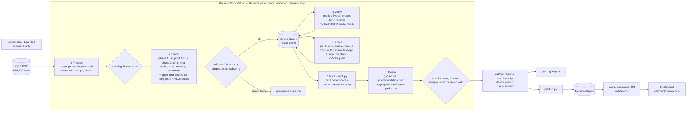

# Spotify Review Insights: a multi-agent review pipeline

**Question:** at the end of the review window, should Spotify's next quarter of product effort go to **access, usability, playback, or billing/support**?

**Answer: usability, starting with excessive ad interruptions (`USB-01`), by making ads less disruptive rather than fewer.** Usability leads the actionable areas: 59,647 complaint/cancellation reviews and severity sum 169,075, vs playback 42,261 / 146,374 and billing/support 46,820 / 136,100 ([`area_totals.csv`](out/full/area_totals.csv)). `USB-01` is the highest-ranked specific issue: 28,764 complaints (C1), mean severity 2.894938 (C2), priority score 83,270 (C3). The #1 baseline row is the catch-all `OTH-99` "general dissatisfaction" (61,635 complaints, C4; priority score 116,400, C5); it names no feature, so it is reported but not treated as a roadmap item. The recommendation was the same at 36% coverage and at 87% coverage. Ads and Premium-only limits are how the free tier earns money: under a declared business lens, 61,170 complaints are about these monetization levers, 37,075 of them in usability ([`business_lens.csv`](out/full/business_lens.csv)). So the memo targets ad frequency, timing and loudness rather than removing ads, and names playback (42,261 complaints, none of them monetization levers) as the alternative with no revenue risk. Final memo: [`out/full/memo_final.md`](out/full/memo_final.md), the student's code-checked revision of the memo agent's draft [`memo.md`](out/full/memo.md). Claims: [`grading/claims.csv`](grading/claims.csv).

| | |
|---|---|
| **Live dashboard** | **https://spotify-review-insights-roan.vercel.app** (public, no login) |
| Backend API (Vercel serverless, reads Neon Postgres) | [`/api/summary`](https://spotify-review-insights-roan.vercel.app/api/summary), [`/api/ranking`](https://spotify-review-insights-roan.vercel.app/api/ranking), [`/api/recommendation`](https://spotify-review-insights-roan.vercel.app/api/recommendation), [`/api/issue?id=USB-01`](https://spotify-review-insights-roan.vercel.app/api/issue?id=USB-01), [`/api/review?id=cd8bf064-c32e-400e-906e-a4d900819bbd`](https://spotify-review-insights-roan.vercel.app/api/review?id=cd8bf064-c32e-400e-906e-a4d900819bbd), [`/api/trend`](https://spotify-review-insights-roan.vercel.app/api/trend), [`/api/evals`](https://spotify-review-insights-roan.vercel.app/api/evals) |
| Database | Neon Postgres: `records` (all 660,622), `issues`, `ranking`, `membership`, `claims`, `memo`, `monthly`, `evals`, `run_meta`. Loaded by [`pipeline/publish.py`](pipeline/publish.py) |
| Grading export | [`grading/`](grading/) (records/calls gzipped). Course checker: [`out/full/self-check.json`](out/full/self-check.json) |
| Result files | [`enriched.jsonl.gz`](out/full/enriched.jsonl.gz) (577,230 completed) · [`quarantine.jsonl.gz`](out/full/quarantine.jsonl.gz) (83,392 with reason + attempts) · [`issues_catalog.json`](out/full/issues_catalog.json) · [`membership.csv`](out/full/membership.csv) · [`aggregates.csv`](out/full/aggregates.csv) · [`ranking.csv`](out/full/ranking.csv) · [`run_log.jsonl`](out/full/run_log.jsonl) · [`run_summary.json`](out/full/run_summary.json) · [`run_manifest.json`](out/full/run_manifest.json) |
| Labels, schema and prompts | **[`LABELS.md`](LABELS.md)** (definitions, rules, worked examples, issue subtopics) · [`schema/output_schema.json`](schema/output_schema.json) · [`prompts/`](prompts/) (Jev questions, quote, verifier, group discover/assign, memo prompts, and all structured-output schemas) · labels and examples in [`pipeline/labels.py`](pipeline/labels.py) |
| Cost calculator | [`cost/`](cost/) · [report](cost/report.md) · offline replay: `python cost/calculator.py` |
| Interruption/resume recording | [4-minute clip](evals/recovery/interruption_resume_short.mp4) · [full take](evals/recovery/interruption_resume_recording.mp4) · [what it shows](evals/recovery/README.md) |

## Results summary

| | |
|---|---|
| Source rows ingested and accounted for | **660,622 / 660,622** (profile exactly matches the course helper; [`ingestion_report.json`](out/ingestion_report.json)) |
| How classification was scoped | **Phase 1 (Jev):** the lowest **100,050** IDs by the course's own seeded hash order (= golden 50 + all dev checkpoints + 90,000 more). **Phase 2 (gpt-6-luna):** every remaining nonempty review, queued in the same order, until the API credit ran out |
| Completed classifications | **577,230 of 660,609 nonempty (87.4%)**. Jev config: 237,987 (78,137 distinct texts + 159,850 exact-text reuses). gpt-6-luna config: 339,243 (322,950 distinct texts + 16,293 reuses) |
| Exact-text cache reuse | 176,143 records reuse a validated label via `cache_source_id`; 401,087 distinct texts were sent to models |
| Quarantined (attempted, failed) | 13 empty texts (`empty_review_text`); 152 gpt-labelled texts whose output was invalid twice (empty or truncated JSON, `max_output_tokens`) |
| Not classified | **83,227** nonempty reviews (12.6%): 83,177 never reached before the credit limit and 50 in flight when the spend cap stopped the run. Exported as `quarantined` with reasons `not_classified_api_credit_limit_reached` / `pending_after_budget`. They are **not** successful classifications and are excluded from every aggregate. They are the highest sample ranks, i.e. a random remainder |
| Golden set (50 human labels; all in phase 1) | topic 60%, intent 82%, severity exact 80% (MAE 0.32), sentiment within ±0.5: 86%; 50/50 quotes are exact substrings ([analysis](evals/golden/error_analysis.md)) |
| Independent verifier, phase 1 (blind **gpt-6-luna** re-labels Jev; seeded 3%, n = 2,345) | topic 87.1%, intent 93.3%, severity 87.4% (MAE 0.14); 632 records with at least one disagreement, [investigated here](evals/verify/README.md) |
| Independent verifier, phase 2 (blind **Jev** re-labels gpt-6-luna; seeded 3%, n = 9,689) | topic 86.3%, intent 92.9%, severity 87.4% (MAE 0.14); 2,750 records with at least one disagreement; planted errors caught 20/20 in both phases |
| System tests (synthetic) | 8/8 passed (4 prompt injections, empty text, non-English, injected HTTP 503 with retry, injected invalid label with retry) + spend-cap stop ([results](evals/system_tests/results.json)) |
| Course checker | all checks pass except the expected `unfinished_classification: 83379` (83,227 not classified + 152 invalid-output quarantines); coverage-point candidate **0.9243** (was 0.6162 at the 100k scope) |
| Measured 100-review pilot | cold **$0.0090**, 69.1 s, 110 calls, 0 failures · warm **0 calls**, 0.67 s ([report](cost/report.md)) |
| Full-run API charges (actual usage × dated rates) | **$14.03** = Jev $4.72 + gpt-6-luna $9.31 ([`run_summary.json`](out/full/run_summary.json)). Phase 1 was $4.95 (projected $4.98). Whole project including pilot, dev runs, tests and demo: **$14.08** (Jev $4.75 + gpt-6-luna $9.33), plus up to about $0.07 that was paid but not logged (see run log) |
| Fresh-input demonstration | all six stages on 40 never-classified reviews from a new CSV: 40/40 completed, 43 calls, $0.0039, 36.8 s ([evidence](evals/fresh_input_demo/README.md)) |
| Full-run enrichment time | phase 1 about 52 min (Jev, 35–40 texts/s); phase 2 about 50 min of active labelling at up to 183 texts/s (gpt-6-luna, 48 batch workers), plus a 15-minute PC sleep and a 4-minute network outage |

Measured numbers are from saved logs; projections are labelled as such in the calculator. "Accounted for" (660,622) is not the same as "completed classifications" (577,230). Spending beyond the instructor's ~$10 guideline was the student's decision, to raise coverage with the remaining prepaid credit.

## Rubric map (evidence links)

**Deliverable quality (4)**
1. *Accessible code/setup and artifacts*: [Setup](#setup) and [Commands](#commands); all outputs are committed (`out/`, `grading/`, `cost/`, `evals/`); [`requirements.txt`](requirements.txt), [`.env.example`](.env.example).
2. *Architecture, shared schema, provenance*: [Architecture](#architecture), the [stage table](#stages-input-output-owner-failure-behaviour-stop-condition) and a [traced example](#one-review-traced-end-to-end). Labels are in [`LABELS.md`](LABELS.md) (generated from [`pipeline/labels.py`](pipeline/labels.py)), the schema in [`schema/output_schema.json`](schema/output_schema.json), all role prompts in [`prompts/`](prompts/). Every record carries `source_sha256` (course `row_sha`) and `label_config`. [`run_manifest.json`](out/full/run_manifest.json) ties together the source checksum, code version, config, prompt hashes, model IDs, run IDs and output checksums.
3. *Memo numbers linked to calculations and evidence*: the final memo [`out/full/memo_final.md`](out/full/memo_final.md) cites C1–C9 in [`grading/claims.csv`](grading/claims.csv), and the course checker recomputes them (0 mismatches). Area totals are in [`area_totals.csv`](out/full/area_totals.csv). Evidence review IDs are in [`memo_input.json`](out/full/memo_input.json). The memo agent's draft passed every code check ([`memo_output.json`](out/full/memo_output.json) `problems: []`). The student's revision passed the same checks, applied to every text field: 9 valid claims, 0 problems ([`memo_final_check.json`](out/full/memo_final_check.json)). Its extra numbers come only from the declared business lens ([`business_lens.json`](out/full/business_lens.json)).
4. *Recommendation, alternatives, limitations*: memo sections "Revenue trade-off", "Alternatives considered" and "Limitations", plus [Limitations](#limitations) below.

**Testing and evaluation (3)**
1. *50 human labels, per-field comparison, error analysis*: [`evals/golden/`](evals/golden/) holds the labels, cases, report, and [error analysis](evals/golden/error_analysis.md) of all 25 disagreements (3 model errors, 15 rule-application, 3 language, 4 ambiguous), plus quote-support and entity inspection and a gpt-only setup comparison. Golden results did not drive any prompt or config change. Index: [`evals/README.md`](evals/README.md).
2. *Independent verification, planted errors, injection*: [`evals/verify/`](evals/verify/README.md) has the procedure, results and disagreement investigation for **both** phases (each verified by the other model family); planted-error cases are 20/20 detected; [`evals/system_tests/`](evals/system_tests/) has the 4 prompt injections plus awkward-path tests.
3. *Real cold/warm pilot, offline calculator, retry/spend/recovery controls*: [`cost/`](cost/) (pilot records/calls, rates, usage, report; the x2-rates check doubles API spend and leaves time unchanged). Retry: injected 503 and invalid-output tests, plus real failures in the log (Jev HTTP 499/529, GPT invalid JSON, `max_output_tokens`, content-filter refusals, connection errors during a PC sleep and a network outage). Spend: ledger reservations plus the spend-cap test. Recovery: [recording](evals/recovery/interruption_resume_short.mp4) and checkpoints ([details](evals/recovery/README.md)).

**Working result (3)**
1. *Full ingestion, coverage, classification*: [`ingestion_report.json`](out/ingestion_report.json), [`grading/records.jsonl.gz`](grading/records.jsonl.gz), checker coverage 0.9243. 87.4% of nonempty reviews are classified; the 83,227 unclassified rows are disclosed with reasons.
2. *Runnable staged program, bounded calls, saved handoffs, resume*: `python -m pipeline run --input any.csv …` ([fresh-input demo](evals/fresh_input_demo/README.md) on a new CSV); enrichment requests are <= 50 reviews (Jev: 1 per request; quotes/verify/assign: <= 50); [`grading/calls.jsonl.gz`](grading/calls.jsonl.gz) has 109,876 attempts. Checkpoints: 131,915 before ⊂ 237,987 after; resume phase calls never include a before-ID.
3. *Reproducible ranking and deployed dashboard*: `python -m pipeline rerank …` reproduces [`ranking.csv`](grading/ranking.csv) byte-for-byte; [dashboard](https://spotify-review-insights-roan.vercel.app) is served by the Vercel API from Neon with live claim checks.

## Architecture



**Stop and retry paths.**
- Transient API errors (408/409/429/499/5xx, timeouts) get bounded exponential backoff with jitter (4 retries).
- An invalid model answer gets exactly one more attempt, then the text is quarantined with its reason. A quote that is still invalid falls back to an exact text prefix with `needs_review`.
- Auth or credit errors (401/402/403, `insufficient_quota`) stop the run.
- One shared spend ledger reserves a worst-case cost before every call and stops admitting work at the cap.
- Ctrl+C finishes in-flight batches, saves them and exits.
- Every attempt, including failures, is in the call log, and each batch commits atomically: calls, labels and statuses in one transaction.

### Why each model call exists (and what code does instead)

| Role | Model / settings | Input -> output | Why a model | What code does |
|---|---|---|---|---|
| Enrich: labels | Jev `jev-1.13.0` (TypeSafe System One) | 1 review -> Choice(topic), Choice(intent), Choice(severity), Score(sentiment) + probabilities ([questions](prompts/jev_questions_v1.json)) | reading messy language into fixed labels | builds questions from [`labels.py`](pipeline/labels.py), maps answers, validates enums and ranges, flags confidence < 0.5 as `needs_review` |
| Enrich: labels (phase 2) | `gpt-6-luna`, reasoning `none` | <= 50 reviews -> topic, intent, severity, sentiment per index ([shared rubric prompt](prompts/verify_system_prompts-v1.txt)) | same as above, at about a third of the Jev pipeline's cost per text once Jev credit ran out | validates every index, enum and range; one retry for invalid items; content-filter refusals isolated per review |
| Enrich: quotes | `gpt-6-luna`, reasoning `none` | <= 50 long reviews (> 200 chars) + labels -> one exact supporting span ([prompt](prompts/quote_v1.txt)) | choosing which span supports the label | short reviews use the whole text as the quote; exact-substring check; entities from a fixed term lexicon ([`enrich.py`](pipeline/enrich.py)) |
| Verify | phase 1: `gpt-6-luna` re-labels Jev; phase 2: Jev re-labels gpt-6-luna | 3% seeded sample per phase, text + rubric only (never the first answer) -> labels | an independent second reading by a different model family | field-by-field comparison, disagreement report, planted-error test |
| Group | `gpt-6-luna`: reasoning `low` to discover, `none` to assign | <= 120 seeded complaint examples per topic -> 3-6 issues; <= 50 complaints/request -> issue ID | naming coherent issues and placing complaints | stable issue IDs, per-topic catch-all `-99`, validates each assignment, saves membership (one issue per complaint) |
| Rank | none | records + membership -> ranking | - | integer arithmetic, half-up 6-dp means, stable tie-break |
| Memo | `gpt-6-luna`, reasoning `low` | top-12 issues + area totals + facts + <= 4 evidence reviews per issue -> structured memo + claims | writing the argument | checks every claim value, issue ID, review ID and number in the prose; one corrective retry; cached by input hash. Its output is the draft; the final memo is the student's revision, checked by the same code |

### Stages: input, output, owner, failure behaviour, stop condition

| Stage | Input | Saved output (handoff) | Owner | Failure behaviour | Stop condition |
|---|---|---|---|---|---|
| 1 Prepare | CSV path | state DB (`source_rows`, `records`), [`ingestion_report.json`](out/ingestion_report.json), [`ingestion.json`](out/ingestion.json), [`data_manifest.json`](out/data_manifest.json) | code | strict CSV parser raises on malformed rows. Later copies of a duplicate ID are reported, not loaded. Empty text is quarantined (`empty_review_text`) | every row read |
| 2 Enrich | pending in-scope distinct texts, batches of <= 50 | `labels` (result cache), record statuses, call log | phase 1 Jev / phase 2 gpt-6-luna (+ gpt quotes); code validates | transient: backoff x4. Invalid: 1 retry, then quarantine. Quote invalid twice: exact prefix + `needs_review`. Auth/credit: stop the run | queue empty, spend cap, time cap, Ctrl+C or `--max-batches` |
| 3 Verify | seeded 3% of each phase's origin records (text only) | [`verify_summary.json`](out/full/verify_summary.json) + [`verify_summary_phase2.json`](out/full/verify_summary_phase2.json), predictions, disagreements and planted-error cases per phase | the other model family; code compares | invalid: 1 retry, then listed as a verifier failure | declared sample done |
| 4 Group | completed complaint/cancellation texts, per topic | [`issues_catalog.json`](out/full/issues_catalog.json), assignments, [`membership.csv`](out/full/membership.csv) | gpt-6-luna; code validates | an issue citing invented example IDs is rejected. Invalid assignment: 1 retry, then the topic catch-all `-99` | every complaint assigned (ungrouped = 0) |
| 5 Rank | records + membership | [`ranking.csv`](out/full/ranking.csv), [`aggregates.csv`](out/full/aggregates.csv), [`area_totals.csv`](out/full/area_totals.csv) | code | deterministic; no model | always completes |
| 6 Memo | top-12 aggregates, area totals, facts, <= 4 evidence reviews per issue | [`memo.md`](out/full/memo.md), [`memo_output.json`](out/full/memo_output.json), [`claims.csv`](out/full/claims.csv) | gpt-6-luna; code checks | any failed claim, ID or number check: 1 corrective retry, then a warning banner with problems listed | checks pass or 2 attempts |
| 6b Final memo (student revision) | the agent's draft and its saved inputs + the declared [business lens](config/business_lens.json) | [`memo_final.md`](out/full/memo_final.md), [`memo_final.json`](out/full/memo_final.json), [`memo_final_check.json`](out/full/memo_final_check.json), [`business_lens.csv`](out/full/business_lens.csv) | student; code checks (`python -m pipeline memo-final`) | any failed claim, ID or number check: warning banner with problems listed | checks pass |
| Publish | saved outputs | Neon tables | code | one transaction, so a failure leaves the previous data intact | committed |

### One review traced end-to-end

Review **`dc3d0e35-dfc6-4d4d-8755-531277cc2394`**: *"This app wants to play all ads today....."* (★5, 2022-11-28, source row 188,172). Trace it live: [`/api/review?id=dc3d0e35-dfc6-4d4d-8755-531277cc2394`](https://spotify-review-insights-roan.vercel.app/api/review?id=dc3d0e35-dfc6-4d4d-8755-531277cc2394).

1. **Source:** `source_sha256 = 70b33c81…86b3ccc` (course `row_sha`, in [`records.jsonl.gz`](grading/records.jsonl.gz)). It is in scope by the course's seeded rank.
2. **Enrichment:** Jev call `typesafe-4f11ac175d154539942a0ba352e2f5bb` (provider id `req_01a13d457a4a70619a4b3d1d982589ee`, phase `initial`, 1,266 input tokens, $0.000053).
   - topic `usability` (p = 1.00), intent `complaint` (p = 1.00), severity `3_degraded` (p = 0.97; next `2_annoyance` 0.03), sentiment Score 0.66, so 0.66/2 − 1 = −0.67.
   - The quote is the whole text (≤ 200 chars) and `needs_review` is false.
   - **The 5-star rating played no part:** labels come from the text only.
3. **Verification:** it is in the seeded 3% sample. The blind verifier call `openai-9056679d08224942913533ff817e77d7` returned usability / complaint / 3 / −0.6, agreeing on all three fields.
4. **Grouping:** assigned to `USB-01` *Excessive ad interruptions* by `openai-e3027a32295c4ae39e627bd8e0bcc7f3`; its row in [`membership.csv`](grading/membership.csv) is `USB-01,dc3d0e35-…`.
5. **Ranking:** `USB-01` is rank 2: complaint_count 28,764, severity_sum 83,270 (this review adds 3), mean_severity 2.894938, priority_score 83,270.
6. **Memo:** claims **C1** (28,764), **C2** (2.894938) and **C3** (83,270) in [`claims.csv`](grading/claims.csv) cite exactly these numbers, and the dashboard re-checks them on every page load.

**A failed case and its handling:** review `9f855846-6620-4eeb-b456-0b12f4c97bf6` (*"Wonderful to access the world's music this way, but sometimes confused by the way that playlists merge into music suggestions…"*).
- Its first Jev call (`typesafe-74e5a2c8359c4be8b6ba60fc35fb503f`, phase A) failed with **HTTP 499 `internal_error`**. 499 was not yet in the retryable set, so the record was left **pending**, not quarantined and not labelled, with `reason = pending_after_transient: HTTP 499 …` and `attempts = 1`.
- The next run re-sent it (`typesafe-18856846ba18444d9c5e7347ce27a95a`, succeeded): usability / complaint / 2 (mixed praise + criticism is a complaint), `attempts = 2`.
- 499 was then added to the retryable statuses.

**An ambiguous case:** golden #11, *"We are boycotting Swedish app in our protest…"*. The human said cancellation; the pipeline said `unclear` (rule: bare boycott slogans are unclear unless a personal departure is stated). Both labels are defensible, and it is recorded as category D in the [error analysis](evals/golden/error_analysis.md).

## Setup

Requirements: Python 3.11+ (tested on 3.13), Node 20+ (dashboard only).

```bash
python -m venv .venv
.venv/Scripts/python -m pip install -r requirements.txt      # Windows; use .venv/bin/python on macOS/Linux
cp .env.example .env    # fill in only the keys you use; .env is git-ignored
```

Dataset: download the course ZIP ([Google Drive](https://drive.google.com/file/d/1P0rUoAS_wVjp3BYKqXMEyD4u0uJP1Bvf/view)) and unzip it into `data/dataset/` (the raw CSV is not committed). `spotify_reviews_18months.csv` must have SHA-256 `1fc85de68a304dd8978b537cfa58793d5f41cbaf417fa32cb53899f83a2fcef6` (97,400,616 bytes). Source: BwandoWando, *3.4 Million Spotify Google Store Reviews* v2, Kaggle, CC0.

Keys: `OPENAI_API_KEY` (gpt-6-luna), `TYPESAFE_API_KEY` (Jev), `DATABASE_URL` (Neon; publish step only). The dashboard reads `DATABASE_URL` from Vercel's encrypted env, never from browser code.

### Database, backend and dashboard setup

The live deployment already exists ([dashboard](https://spotify-review-insights-roan.vercel.app), public, no login). To reproduce it:

1. **Database:** create a Postgres database. We used a free [Neon](https://console.neon.tech) project. Put its connection string in `.env` as `DATABASE_URL=postgresql://…`.
2. **Load the data:** `python -m pipeline publish --state state/full.sqlite --analysis out/full`. This creates the tables ([DDL in `pipeline/publish.py`](pipeline/publish.py)) and loads all 660,622 records, issues, ranking, membership, claims, memo, monthly trend and eval summaries in **one transaction**. Rerunning replaces the data atomically.
3. **Backend + dashboard:** in [`web/`](web/), `vercel link`, then `vercel env add DATABASE_URL production` (paste the same string; stored encrypted, server-side only), then `vercel deploy --prod`. The serverless routes in [`web/api/`](web/api/) query Postgres with parameterized, read-only SQL ([`@neondatabase/serverless`](web/package.json), pinned 1.1.0). The static page [`web/public/index.html`](web/public/index.html) calls only those routes.
4. **Verify:** open `/api/recommendation`. Every claim row has `matches: true` when the published claims equal the published ranking.

## Commands

**Free (no API key, no model calls):**

```bash
python cost/calculator.py                                     # offline cost/runtime replay (stdlib only)
python cost/calculator.py --rates-multiplier 2 --out /tmp/x   # what-if: all API rates doubled
python -m pipeline rerank --records grading/records.jsonl.gz --membership grading/membership.csv --out ranking_check.csv
python tools/check_submission.py profile --full data/dataset/spotify_reviews_18months.csv --out ingestion_check.json
```

**Paid (explicit; needs `.env` keys):**

```bash
python -m pipeline pilot --confirm-paid                        # measured cold + warm 100-review pilot -> cost/
python -m pipeline run --input any.csv --state state/x.sqlite --out out/x    # all six stages on any CSV
# How the full run was executed:
python -m pipeline ingest --input data/dataset/spotify_reviews_18months.csv --state state/full.sqlite --scope-size 100050
python -m pipeline enrich --state state/full.sqlite --phase initial          # (interrupted with Ctrl+C)
python -m pipeline snapshot --state state/full.sqlite --out out/full/checkpoint_before.json
python -m pipeline enrich --state state/full.sqlite --phase resume
python -m pipeline snapshot --state state/full.sqlite --out out/full/checkpoint_after.json
python -m pipeline analyze --state state/full.sqlite --out out/full          # verify, group, rank, memo (phase 1)
# Phase 2 (Oct 20): remaining reviews with gpt-6-luna, in course sample order, until the credit limit
python -m pipeline enrich --state state/full.sqlite --backend luna --extend-scope --batch-workers 48 --spend-cap 11.80
python -m pipeline analyze --state state/full.sqlite --out out/full --spend-cap 14.50   # + Jev verifier for phase 2
python -m pipeline memo-final --out out/full                                # code-check the student's revised memo (no model calls)
python -m pipeline report  --state state/full.sqlite --out out/full          # run_log, run_summary, enriched, quarantine
python -m pipeline prompts                                                   # write every role prompt to prompts/
python -m pipeline grading --state state/full.sqlite --analysis out/full --checkpoints out/full --out grading
python -m pipeline publish --state state/full.sqlite --analysis out/full     # -> Neon (needs DATABASE_URL)
python -m pipeline manifest --state state/full.sqlite --out out/full/run_manifest.json
cd web && vercel deploy --prod                                               # dashboard + API
```

## Run log (what actually happened, in order)

1. **Ingest (Oct 12):** full file profiled. Counts all match the brief: 13 empty, 159,701 missing app versions, 0 duplicate IDs, 484,189 distinct nonempty texts. The course samples are exactly the first IDs in our rank order.
2. **Dev checkpoint 500 (Oct 14):** 479 distinct texts, $0.027, 31 s, 0 failures. Its group/memo test led to prompt fixes before the pilot (catch-all overuse, memo must address the #1 issue).
3. **100-review pilot:** cold run of every stage with one worker; warm rerun made 0 calls ([`cost/report.md`](cost/report.md)).
4. **System tests:** 8/8 plus the spend-cap stop.
5. **Full run, phase A (Oct 14)**, the first 10,050 ranked IDs (= golden + analysis_10000 = 8,492 texts):
   - Part 1 ran at about 3 texts/s because a cache-fill query scanned every pending row per batch. Then the process was ended by an agent-session restart at 19:08, mid-batch.
   - SQLite rolled back cleanly; all 3,750 saved labels have call evidence.
   - **Known gap:** up to 4 in-flight batches (≤ 200 Jev calls, ≤ about $0.011) were paid but never logged; their texts were re-sent.
   - After the query fix, part 2 ran at 35 texts/s. This is the 10k refresh in the calculator.
6. **Interruption/resume demo (Oct 16, recorded):**
   - The `initial` run was stopped with Ctrl+C after 15 batches and saved its in-flight work (`stop_reason: interrupted`).
   - Snapshot: 131,915 completed IDs. The `resume` run then printed "131,915 IDs already completed and saved (never re-sent)" and finished the remaining 68,896 texts.
   - **Known gap:** the interrupt handler dropped one finished batch before committing it (ledger $0.528059 vs logged $0.525200, so $0.002859). Its texts stayed pending and were re-sent. Fixed in `enrich.py` (wait before pop).
7. **Analyze (Oct 17):**
   - Verifier sample of 2,345: one batch failed validation twice and was retried successfully on rerun.
   - The group stage first hit a slow query (an EXISTS planned as a scan) and was stopped before any further paid calls, fixed and rerun. Verification was cached, so nothing was paid twice.
   - The memo was regenerated twice: `memo-v3` fixed the evidence pack (prefer short reviews whose full text is shown) and required numbers for every alternative; `memo-v4` (Oct 19) required complaint_count, mean_severity and priority_score claims for the lead issue. Each passed every code check on the first attempt. Earlier versions are not used; all three calls are in the call log.
8. **Phase 2 (Oct 20): the remaining reviews with gpt-6-luna.** Jev credit was nearly used up, and the golden comparison showed gpt-6-luna labelling about as well (66% vs 60% topic) at roughly a third of the cost per text. The remaining 406,052 distinct texts were queued in course sample order with a spend cap that left enough credit to group every new complaint.
   - **Test:** 200 texts, $0.0038, 0 failures.
   - **Run 1** was stopped after 3 minutes for two fixes. (a) Batches were committed strictly in submission order, so one slow batch stalled 47 finished ones; they now commit as soon as they finish, and commits are idempotent. (b) Answers followed by trailing text were rejected; the parser now keeps the first complete JSON value and still validates every item. 177 texts quarantined only because of (b) were re-queued, recorded in the run log, and labelled.
   - **Run 2** labelled 212,100 texts. The PC slept from 13:07 to 13:22 and the network dropped from 13:26 to 13:30; the connection errors cost $0 and left 19,550 texts pending, which run 3 picked up first. At 13:40 a response that was a bare JSON list crashed the run. **Known gap:** up to 48 in-flight batches (at most about $0.05) were paid but not logged; their texts stayed pending and were re-sent. Fixes: tolerant item parsing in every stage, a per-batch crash guard, a circuit breaker that pauses during outages, and per-review isolation of content-filter refusals.
   - **Run 3** labelled 101,900 texts at 183 texts/s and stopped at the spend cap (`stop_reason: spend_cap_reached`).
   - **Analyze:** Jev verified a seeded 3% of the gpt-labelled origins (9,689 calls, $0.52). Grouping assigned the 171,230 new complaint texts to the **same 44-issue catalog** (no re-discovery; 0 fallbacks; 0 ungrouped). The memo was regenerated on the new numbers and passed every code check on the first attempt.
9. **Real failures in the log:** 2,750 failed attempts out of 109,876. Of these, 2,634 were connection errors or timeouts during the sleep and the outage (`usage_status: unknown_possible_charge`; very likely unbilled). The rest were `max_output_tokens` (56), invalid JSON (47), content-filter refusals (7), Jev HTTP 499/529 (4), one Cloudflare HTTP 520, and one memo call refused because the OpenAI credit was exhausted (HTTP 429 `insufficient_quota`, $0; see item 10). All were retried or recorded with a reason.
10. **Memo revision (Oct 20, after phase 2):** the student judged that the draft's "reduce ads" framing ignored that ads and Premium-only limits fund the free tier. A `memo-v5` prompt with a revenue trade-off rule was written, but its single call failed because the OpenAI credit was used up. The student therefore revised the memo by hand, with the coding assistant. The revision keeps the recommendation (usability, `USB-01`) and reframes it as making ads less disruptive. It adds a "Revenue trade-off" section based on a declared [business lens](config/business_lens.json) (7 issues tagged as monetization levers; `BIL-99` is left untagged because it mixes price complaints with billing errors), and names playback as the alternative with no revenue risk. It passed the same code checks as the draft (`python -m pipeline memo-final`: 9 valid claims, 0 problems). The prompt change was reverted, so the cached `memo-v4` draft stays reproducible with 0 new calls.

## Concurrency, limits and run timing

- **Chosen concurrency**: phase 1 used 4 batch workers × 8 Jev workers, with a shared rate limiter at 50 requests/s (Jev's documented limit is 80/s). Phase 2 used 48 gpt batch workers (OpenAI Build tier: 5,000 RPM / 2M TPM). One spend ledger is shared across all workers.
  - It was stepped up from the pilot (1 × 1) to the 500 checkpoint (2 × 8) to the full run (4 × 8).
  - Measured throughput: 35–40 texts/s (phase 1) and up to 183 texts/s (phase 2), with **0 rate-limit (429) errors** in either phase.
  - These throughputs come from different review sets, so they are observations, not a controlled same-review worker comparison.
- **Spending controls:**
  - In code: a cap with worst-case reservation before every call ($10 for phase 1; raised to $11.80 for phase-2 labelling and $14.50 for its analysis, sized to the remaining prepaid credit). The [spend-cap test](evals/system_tests/results.json) stopped before any spend, and phase 2 stopped at its cap.
  - At the providers: a prepaid OpenAI balance with auto-recharge off, and a prepaid Jev balance. Neither provider can bill beyond its prepaid amount.
- **Timeouts with unknown charges:** none in phase 1. In phase 2, 2,634 attempts failed with connection errors or timeouts while the PC slept or the network was down (`usage_status: unknown_possible_charge`, counted at $0). Connection errors are almost certainly unbilled; the provider dashboards would settle it. Failed attempts that were billed are counted at their reported usage.
- **Provider prompt caching** (separate from our result cache): 9.16M cached gpt-6-luna input tokens, mostly the repeated rubric prompt in phase 2, saving about $0.82 vs uncached rates. Measured, already reflected in costs.
- **Full-run stage wall clock** (first call start to last call end, [`run_summary.json`](out/full/run_summary.json) `stage_wall_clock_from_calls`):

| Stage | Wall clock |
|---|---|
| Ingest | 175 s (all 660,622 rows: parse, hash, profile, dedupe, scope) |
| Enrich | 1,243 s (phase A part 1, before the query fix) + 118 s (part 2) + 28 s (interrupted run) + 1,706 s (resume) ≈ 52 min |
| Verify | 524 s |
| Group | 564 s |
| Phase 2 enrich (gpt-6-luna) | 212 s (run 1) + 2,246 s (run 2, including the 15-min sleep and outage) + 558 s (run 3) ≈ 50 min |
| Phase 2 verify (Jev) | 207 s |
| Phase 2 group (171,230 new complaint texts) | 2,507 s |
| Rank (final) | 39 s |
| Memo (final) | 40 s |

## Baseline ranking rules

- **Records counted:** completed records with intent `complaint` or `cancellation` only; praise, requests and `unclear` are excluded. Scope is the 577,230 completed classifications from both phases; pending and quarantined rows are never counted.
- **Membership:** each such review belongs to **exactly one** issue (`allow_multi_issue: false`), assigned from its exact text. Reviews reusing a label via `cache_source_id` are counted individually, as the contract requires.
- **Score:** `priority_score = complaint_count × mean_severity = severity_sum` (integer arithmetic).
- **Means:** 6 decimals, decimal half-up.
- **Order:** descending score, then ascending issue ID; ranks start at 1.
- **Catch-alls:** issues ending in `-99` are per-topic catch-alls. They stay in the baseline (`OTH-99` is rank 1) and the memo explains why it is not a feature target.
- **Area totals** ([`area_totals.csv`](out/full/area_totals.csv)) sum the same membership by topic group (playback = playback + downloads; billing/support = billing + support). They are context for the memo, not part of the baseline score.
- **Business lens (revenue trade-off):** [`config/business_lens.json`](config/business_lens.json) tags 7 issues whose complaints are about how the free tier earns money (ads, Premium-only controls, skip limits). [`business_lens.csv`](out/full/business_lens.csv) splits each area's complaints into monetization-lever and remaining complaints, using code only. The contract allows an extra business view next to the baseline; the baseline ranking is unchanged.

## Design choices

- **Scope (budget), in two phases:** the instructor's guidance was about $10 for 100k reviews, and the calculator projected $31–48 for the full corpus with Jev.
  - Phase 1 classified the lowest 100,050 IDs by the course's seeded SHA-256 order (a uniform random sample, extending the course's own samples) with Jev.
  - Phase 2 queued every remaining review in the same order and labelled it with gpt-6-luna until the remaining prepaid credit ran out.
  - Exact-text duplicates anywhere in the file reuse a validated label. Because both phases follow the random order, the 13% left unclassified is a random remainder, not a biased slice.
- **Jev for fixed labels:** recommended by the instructor. It costs $0.042 per 1M input tokens with free output (about $0.000054 per review), returns per-option probabilities that drive `needs_review`, and makes injection structurally hard because it can only return probabilities over fixed options.
  - On the golden 50, a gpt-6-luna-only labeller scored about the same (topic 66% vs 60%, a 3-review difference); see the [error analysis](evals/golden/error_analysis.md).
- **Two labelling configs, one taxonomy:** both phases use the same rubric ([`LABELS.md`](LABELS.md)), schema and quote step. Each record carries its own `label_config`, cache reuse never crosses configs, and both configs feed one ranking.
  - Cross-family agreement is similar in both directions (topic 87.1% and 86.3%).
  - `needs_review` is confidence-based only for Jev labels (20,122 of 237,987 flagged). gpt-6-luna returns no probabilities, so its records are flagged only for quote fallbacks or non-Latin script (2,674 of 339,243).
- **Verifier from a different model family** in both phases (GPT checks Jev; Jev checks GPT), blind to the first label.
- **Severity as a Choice over 5 defined levels** (integer, no conversion). **Sentiment as a 5-level Score:** `sentiment = score/2 - 1`.
- **One issue per complaint** (`allow_multi_issue: false`), with per-topic catch-alls (`-99`) so no complaint is dropped.
- **Exact-text cache key:** text SHA-256 plus the full `label_config` (`jev-1.13.0+gpt-6-luna/none+prompts-v1+schema-v1+labels-v1`). Any model, prompt or schema change means new work.
- **Model allowlist:** `model_allowlist: ["jev-1.13.0", "gpt-6-luna"]` in [`run_config.json`](config/run_config.json). Loading the config fails if any stage names another model. The allowlist check was added after phase 1; the call log confirms both phases used only these two models (87,827 Jev and 22,045 gpt-6-luna attempts). No stronger-model fallback is configured.
- **Where code decides vs where models judge:** code chooses every next step: which texts are pending, batching, retries, quarantine, cache reuse, which sample to verify, when to stop, and all counting and arithmetic. Models only answer bounded questions about review language (labels, quote span, issue name/assignment, memo prose), and every answer is validated in code before it is saved.

## Trend (all classified reviews; first and last months partial)

Denominator = classified reviews in the period. Coverage is 85–90% in every period, and the unclassified remainder is the random tail of the sample order, so periods are comparable.

| Period | Classified (of nonempty) | Complaints | Generic `other` complaints | `unclear` | Usability complaints |
|---|---|---|---|---|---|
| Baseline: 2022-06 to 2023-06 full months, excl. Mar–Apr 2023 | 273,278 of 312,120 (88%) | 82,890 (30.3%) | 9,436 (3.5%) | 19,728 (7.2%) | 26,999 (9.9%) |
| 2023-03 to 2023-04 | 45,497 of 52,251 (87%) | 15,097 (33.2%) | 1,274 (2.8%) | 2,927 (6.4%) | **6,693 (14.7%)** |
| **2023-07** (volume about 3x a typical month) | 76,465 of 85,079 (90%) | 44,043 (57.6%) | **34,034 (44.5%)** | **16,621 (21.7%)** | 3,874 (5.1%) |
| 2023-10 | 76,135 of 89,102 (85%) | 55,866 (73.4%) | 19,488 (25.6%) | 4,140 (5.4%) | 9,819 (12.9%) |
| 2022-05 (partial month) | 13,611 of 15,461 (88%) | 3,991 (29.3%) | 432 (3.2%) | 1,032 (7.6%) | 1,216 (8.9%) |
| 2023-11 (partial month) | 29,655 of 34,524 (86%) | 20,253 (68.3%) | 7,836 (26.4%) | 1,768 (6.0%) | 3,710 (12.5%) |

- July 2023 is dominated by generic complaints and `unclear` texts, largely boycott slogans.
- Usability complaints rise from 9.9% to 14.7% in Mar–Apr 2023, then stay at about 12.5–12.9% in Oct–Nov 2023.

The same pattern held on the phase-1 sample alone. Monthly rows are in [`/api/trend`](https://spotify-review-insights-roan.vercel.app/api/trend). These are observations, not causal claims.

## Limitations

- **Revenue lens is a judgment:** the monetization-lever tags were declared after reading the first memo draft, apply to whole issues, and use no revenue data. Any change to ads should be tested against ad revenue and Premium upgrades.
- **Incomplete classification:** 83,227 nonempty reviews (12.6%) were not classified before the API credit ran out, plus 152 quarantined after invalid output twice. They are visible in `records.jsonl.gz` with explicit reasons and excluded from all aggregates. The remainder is the random tail of the sample order.
- **Label quality:** golden topic agreement is 60% (n = 50, mostly rule-application differences; the golden 50 are all in phase 1). Cross-family verifiers agree on about 86–87% of topics. Topic is the weakest field, and catch-all issues (`OTH-99`, `BIL-99`, `PLB-99`) absorb vague complaints.
- **Mixed labellers:** 41% of completed records are Jev-labelled and 59% gpt-6-luna-labelled. Each was checked by the other at about 86–87% topic agreement, but systematic differences between them at topic boundaries cannot be ruled out. `needs_review` carries less signal for gpt-labelled records.
- **Review bias:** self-selected, historical public reviews. No revenue, plan tier or confirmed churn; cancellation language is intent. Text was not translated; non-Latin scripts are flagged.
- **Missing data:** 159,701 rows have no `app_version`. Classification uses `review_text` only (`classification_input_fields: ["review_text"]`), so a missing version never blocks or changes a label; version-level analysis is not attempted. Star ratings are kept as metadata and never used for labels (the traced example is a 5-star complaint). Timestamps have no timezone, and months are taken as written.
- **Benchmark coverage:** the instructors' private label sample counts missing predictions as incorrect, so the 12.6% unclassified will score as misses there.
- **Process gaps:** unlogged paid calls from three incidents (≤ about $0.014 in phase 1, ≤ about $0.05 from the phase-2 crash), plus 2,634 connection-error attempts with unknown (very likely zero) charges. The memo was regenerated as prompts and data changed (v3, v4, then on the phase-2 numbers). The final memo is a hand revision of the v4 draft, because the revised prompt could not run without OpenAI credit. The golden comparison came after the phase-1 setup was chosen, because the human labels arrived late.
- **Budget:** total API spend ($14.08) exceeds the instructor's ~$10 guideline; the extra was the student's decision to raise coverage from 36% to 87%.
- **Charges** are usage × dated list prices, not provider invoices.
